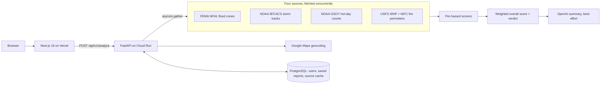

<div align="center">

# 🌍 Climate Risk Intelligence Platform

**Enter a U.S. address, get flood, hurricane, heat and wildfire risk scores from public government data, in seconds.**

### [▶ Try the live app](https://climate-risk-platform-seven.vercel.app)

[](https://github.com/dagim-dev/climate-risk-platform/actions/workflows/ci.yml)
[](LICENSE)
[](CHANGELOG.md)
[](https://www.python.org/)
[](https://nextjs.org/)

</div>

---

## What it does

Type any U.S. address and the app returns:

- Four hazard scores from 0 to 100: **Flood**, **Hurricane**, **Heat** and **Wildfire**, each with a severity, a confidence level and the facts behind it
- An overall score and a **Go / Caution / Avoid** verdict
- A plain-English summary written by an LLM from those scores only
- A printable report, plus saved properties and PDF downloads for signed-in users

The product is free. There is no paid tier.

## What makes it different: it does not guess

Every score comes from a live query to FEMA, NOAA, USFS or NIFC. When a source is down or has no data for a location, the app says so instead of filling the gap:

- A hazard with no data is reported as **unavailable** with `score: null`, never as 0 or "low"
- The overall verdict is **withheld** unless all four hazards were assessed
- A cached result used during a provider outage is marked **stale** with its date
- Areas FEMA has not mapped (zone D, or no flood polygon) are unavailable, not "minimal risk"
- The LLM prompt forbids describing or estimating a hazard that was not assessed

## How it works



1. **Geocode** the address with Google Maps. A bad address is a 400; a provider failure is a 502.
2. **Fetch** the four climate sources concurrently. Each successful payload is saved to a cache table keyed by source and a 0.01° lat/lon cell. If a live fetch fails, the cached copy is used when it is recent enough (24 hours to 30 days depending on the source).
3. **Score** each hazard with its own scorer (`backend/app/services/scoring/`).
4. **Aggregate** with weights flood 0.30, hurricane 0.30, heat 0.20, wildfire 0.20 over the hazards that were assessed. A single hazard at 70 or above raises "Go" to "Caution".
5. **Summarize** with GPT-4o-mini. If that call fails, the report is still returned with `ai_summary: null`.

The app explains its scoring in plain language on the [methodology page](https://climate-risk-platform-seven.vercel.app/methodology). The scoring rules, endpoints and station selection are documented in [`docs/data-sources.md`](docs/data-sources.md).

### Known limits

- Scores are rule-based and have not yet been validated against loss data such as insurance claims.
- Scores describe today only. Future climate projections are not shown yet.
- The source cache is a fallback only, so every analysis calls the live providers and takes a few seconds.
- The rate limiter keeps counts in memory per backend instance.

## Tech stack

| Layer | Technology |
|---|---|
| **Frontend** | Next.js 16 (App Router), React 19, TypeScript, Tailwind CSS 4, Auth.js (NextAuth v5) |
| **Backend** | Python 3.12, FastAPI, async SQLAlchemy, Alembic, httpx |
| **Database** | PostgreSQL 16 |
| **AI** | OpenAI GPT-4o-mini |
| **Auth** | Email/password and Google sign-in; the backend verifies the Google ID token and issues its own JWT |
| **Data sources** | FEMA NFHL (with Esri Living Atlas mirror), NOAA IBTrACS, NOAA CDO GSOY, USFS Wildfire Hazard Potential, NIFC fire perimeters |
| **Hosting** | Vercel (frontend), Google Cloud Run (backend), Supabase (Postgres) |
| **Monitoring** | Sentry |
| **Testing & CI** | Pytest, Playwright, GitHub Actions |
| **Containers** | Docker, Docker Compose |

## Getting started

### Prerequisites

- [Node.js](https://nodejs.org/) 20 or higher
- [Python](https://www.python.org/) 3.12 or higher
- [Docker](https://www.docker.com/) and Docker Compose

API keys:

| Provider | Used for | Link |
|---|---|---|
| Google Maps Platform | Address geocoding | [console.cloud.google.com](https://console.cloud.google.com/) |
| OpenAI | Risk summary | [platform.openai.com](https://platform.openai.com/) |
| NOAA Climate Data Online | Heat data | [ncdc.noaa.gov/cdo-web](https://www.ncdc.noaa.gov/cdo-web/) |

FEMA, IBTrACS, USFS and NIFC need no key.

### Install

```bash
git clone https://github.com/dagim-dev/climate-risk-platform.git
cd climate-risk-platform
cp frontend/.env.example frontend/.env.local
cp backend/.env.example backend/.env
```

Fill in both env files (see below), then either use Docker or install by hand:

```bash
cd frontend && npm install && cd ..

cd backend
python -m venv .venv
source .venv/bin/activate     # macOS/Linux
# .venv\Scripts\activate      # Windows
pip install -r requirements-dev.txt
cd ..
```

## Environment variables

### Frontend — `frontend/.env.local`

| Variable | Description | Required |
|---|---|:---:|
| `NEXT_PUBLIC_API_URL` | Base URL of the FastAPI backend | ✅ |
| `API_INTERNAL_URL` | Backend URL for server-side calls when it differs from the browser URL (Docker: `http://backend:8000`) | |
| `AUTH_SECRET` | Auth.js secret | ✅ |
| `AUTH_URL` | Frontend origin (`http://localhost:3000` locally; `NEXTAUTH_URL` also works) | ✅ |
| `AUTH_TRUST_HOST` | `true` when not hosted on Vercel (Docker, Cloud Run) | |
| `GOOGLE_CLIENT_ID` | Google OAuth client ID | ✅ for Google sign-in |
| `GOOGLE_CLIENT_SECRET` | Google OAuth client secret | ✅ for Google sign-in |
| `NEXT_PUBLIC_SENTRY_DSN` | Sentry DSN for error monitoring | |

### Backend — `backend/.env`

| Variable | Description | Required |
|---|---|:---:|
| `DATABASE_URL` | PostgreSQL async connection string | ✅ |
| `GOOGLE_MAPS_API_KEY` | Google Maps Geocoding API key | ✅ |
| `OPENAI_API_KEY` | OpenAI API key for the summary | ✅ |
| `NOAA_API_KEY` | NOAA Climate Data Online token | ✅ for heat data |
| `GOOGLE_CLIENT_ID` | Google OAuth client ID (must match the frontend) | ✅ for Google sign-in |
| `JWT_SECRET` | Signing secret for access and PDF tokens | ✅ in production |
| `CORS_ORIGINS` | Comma-separated allowed origins (default `http://localhost:3000`) | |
| `ENVIRONMENT` | `development` or `production` (`/debug/sentry-test` exists only in `development`) | |
| `API_BASE_URL` | Public backend URL used in signed PDF links (default `http://localhost:8000`) | ✅ in production |
| `APP_VERSION` | Reported on `/health` | |
| `SENTRY_DSN` | Sentry DSN for error monitoring | |
| `ANALYZE_RATE_LIMIT_PER_MINUTE` / `ANALYZE_RATE_LIMIT_PER_DAY` | Per-IP limits on `/analyze` (default 10 and 100) | |

## Running the application

### Option A — Docker Compose

```bash
docker-compose up --build
```

| Service | URL |
|---|---|
| Frontend (Next.js) | http://localhost:3000 |
| Backend API (FastAPI) | http://localhost:8000 |
| Interactive API docs | http://localhost:8000/docs |
| PostgreSQL | localhost:5432 |

The backend container runs `alembic upgrade head` on start. Inside Compose the backend reaches Postgres at `db:5432`, which overrides the `localhost` URL in `backend/.env`.

### Option B — Manual

With PostgreSQL running locally:

```bash
cd backend
source .venv/bin/activate
alembic upgrade head
uvicorn app.main:app --reload --port 8000
```

In a second terminal:

```bash
cd frontend
npm run dev
```

Open [http://localhost:3000](http://localhost:3000).

## API reference

Swagger UI is served at `/docs` on the backend.

| Method | Path | Auth | Purpose |
|---|---|---|---|
| `GET` | `/health` | Public | Status and version |
| `POST` | `/api/v1/analyze` | Public, rate limited | Full four-hazard analysis for an address |
| `POST` | `/api/v1/auth/register` | Public | Create an account |
| `POST` | `/api/v1/auth/login` | Public | Email/password sign-in |
| `POST` | `/api/v1/auth/oauth` | Google ID token | Google sign-in |
| `GET` | `/api/v1/auth/me` | JWT | Current user |
| `GET` / `POST` | `/api/v1/properties` | JWT | List or save properties |
| `DELETE` | `/api/v1/properties/{id}` | JWT | Delete a saved property |
| `POST` | `/api/v1/properties/{id}/pdf` | JWT | Get a signed, expiring PDF link |
| `GET` | `/api/v1/properties/{id}/pdf/download` | Signed token | Download the PDF |

### `POST /api/v1/analyze`

Rate limited per client IP (10 per minute and 100 per day by default). Over the limit it returns `429` with a `Retry-After` header. `address` is capped at 300 characters.

**Request:**

```json
{ "address": "1600 Pennsylvania Avenue NW, Washington, DC" }
```

**Response `200 OK`** (real output from 2026-11-10; `ai_summary` shortened, the other three hazards and sources have the same shape as the ones shown):

```json
{
  "address": "1600 Pennsylvania Ave NW, Washington, DC 20500, USA",
  "latitude": 38.8975862,
  "longitude": -77.0366871,
  "flood_risk": {
    "status": "ok",
    "score": 12,
    "severity": "Low",
    "confidence": "High",
    "primary_factors": ["FEMA flood zone X (minimal flood hazard)"],
    "as_of": "2026-11-10T00:10:48.112983+00:00",
    "unavailable_reason": null
  },
  "heat_risk": {
    "status": "ok",
    "score": 44,
    "severity": "Moderate",
    "confidence": "High",
    "primary_factors": [
      "39 days per year at or above 90°F (NOAA)",
      "Urban heat island effect in major metro area (+8 points)",
      "Hot days rising by about 6 per decade over 1996–2025 (NOAA)"
    ],
    "as_of": "2026-11-10T00:10:48.963243+00:00",
    "unavailable_reason": null
  },
  "hurricane_risk": { "status": "ok", "score": 6, "severity": "Low", "...": "..." },
  "wildfire_risk": { "status": "ok", "score": 3, "severity": "Low", "...": "..." },
  "overall_risk_score": 15,
  "overall_status": "complete",
  "verdict": "Go",
  "verdict_reason": null,
  "sources": {
    "fema_nfhl": { "status": "ok", "as_of": "2026-11-10T00:10:48.112983+00:00", "error": null },
    "ibtracs": { "status": "ok", "...": "..." },
    "noaa_heat": { "status": "ok", "...": "..." },
    "wfigs": { "status": "ok", "...": "..." }
  },
  "ai_summary": "The climate risk assessment for 1600 Pennsylvania Ave NW ... The single biggest risk driver among the assessed hazards is heat ...",
  "generated_at": "2026-11-10T00:10:49.069374+00:00"
}
```

Field notes:

- `status` on a hazard or source is `ok`, `stale` (cached copy used during an outage) or `unavailable`.
- An unavailable hazard has `score: null`, `severity: null` and an `unavailable_reason`.
- `overall_status` is `complete`, `partial` or `unavailable`. `verdict` is `null` unless it is `complete`.
- `ai_summary` is `null` when the LLM call fails.

**Errors:** `400` address could not be geocoded · `429` rate limited · `502` geocoding provider unavailable · `500` analysis failed.

## Project structure

```
climate-risk-platform/
├── frontend/                     # Next.js application
│   ├── src/
│   │   ├── app/
│   │   │   ├── (site)/           # Pages that share the Header/Footer layout
│   │   │   └── report/           # Standalone printable report
│   │   ├── components/           # dashboard/, layout/, auth/, ui/
│   │   ├── lib/                  # api-client.ts, report-storage.ts, ...
│   │   ├── types/risk.ts         # Mirrors backend/app/schemas/risk.py
│   │   ├── auth.config.ts        # Auth.js providers and callbacks
│   │   └── proxy.ts              # Route protection (Next 16 middleware)
│   └── tests/e2e/                # Playwright tests (backend mocked)
│
├── backend/                      # FastAPI application
│   ├── app/
│   │   ├── api/v1/endpoints/     # risk.py, auth.py, properties.py
│   │   ├── core/                 # config, database, security, rate limit, Sentry
│   │   ├── models/               # SQLAlchemy models
│   │   ├── schemas/              # Pydantic request/response schemas
│   │   └── services/
│   │       ├── geocoding.py
│   │       ├── climate/          # One fetcher per source + source_cache.py
│   │       ├── scoring/          # One scorer per hazard, aggregator
│   │       ├── ai/               # Prompt builder and summary generator
│   │       └── pdf/              # On-demand PDF rendering
│   ├── alembic/                  # Database migrations
│   └── tests/                    # Pytest suite
│
├── docs/                         # data-sources, design-system, production-deployment
├── infrastructure/               # Cloud Run service definition, env template
├── scripts/                      # Provisioning scripts
├── .github/workflows/            # ci.yml, deploy.yml
├── docker-compose.yml
├── CHANGELOG.md
└── TODO.md
```

## Running tests

Backend (about 120 tests; uses a temporary SQLite database and mocked HTTP, so no Postgres or API keys are needed):

```bash
cd backend
source .venv/bin/activate
pytest tests/ -v --cov=app --cov-report=term-missing
```

Frontend end-to-end (30 Playwright tests; the backend is mocked):

```bash
cd frontend
npx playwright test --project=chromium
```

CI runs the backend tests, `npm run lint`, `npx tsc --noEmit` and the Playwright suite on every push and pull request to `develop` and `main`.

## Deployment

The app is live:

| Component | Host |
|---|---|
| Frontend | Vercel — https://climate-risk-platform-seven.vercel.app |
| Backend | Google Cloud Run |
| Database | Supabase (PostgreSQL) |

- Releases are tagged on `main`. `deploy.yml` is triggered manually (`workflow_dispatch`); it does not run on push.
- Database migrations are applied by hand with `alembic upgrade head`.
- The backend allows unauthenticated requests because `/analyze` is public; it is rate limited per IP.
- PDFs are rendered on each download and never written to disk, because Cloud Run's filesystem is ephemeral.
- Production requires a real `JWT_SECRET`; the app refuses to start without one.

See [`docs/production-deployment.md`](docs/production-deployment.md) for provisioning steps.

## Roadmap

| Version | Status | Milestone |
|---|---|---|
| `v0.1-alpha` – `v0.3-alpha` | ✅ | Scaffolding, CI, geocoding, data integrations, scoring engine, frontend |
| `v1.0.0` | ✅ | AI summaries, printable reports, E2E tests |
| `v2.0.0` | ✅ | Accounts, saved properties, PDFs |
| `v2.1.0` | ✅ | First production deploy; data-accuracy and security fixes |
| `v2.2.0` | ✅ | Methodology page; saved-report size and property-count limits |
| Next | 🔜 | Validate scores against loss data, climate-model projections, bulk (CSV) analysis |

See [`CHANGELOG.md`](CHANGELOG.md) for what changed in each release and [`TODO.md`](TODO.md) for the task breakdown.

## Contributing

1. Cut a branch from `develop`: `git checkout -b feature/your-feature-name`
2. Write your changes and tests
3. Commit using Conventional Commits: `feat(scope): description`
4. Open a pull request targeting `develop` and make sure CI passes

## Data sources

| Source | Used for | Link |
|---|---|---|
| **FEMA National Flood Hazard Layer** | Flood zone at the property | [fema.gov/flood-maps](https://www.fema.gov/flood-maps) |
| **NOAA IBTrACS** | Storm tracks within 100 km over the last 50 years | [ncei.noaa.gov/products/international-best-track-archive](https://www.ncei.noaa.gov/products/international-best-track-archive) |
| **NOAA Climate Data Online (GSOY)** | Days per year at or above 90°F, and their trend | [ncdc.noaa.gov/cdo-web](https://www.ncdc.noaa.gov/cdo-web/) |
| **USFS Wildfire Hazard Potential (2023)** | Wildfire hazard class of the land around the property | [wildfirerisk.org](https://wildfirerisk.org/) |
| **NIFC fire perimeters** | Wildfire perimeters within 50 km over the last 20 years | [data-nifc.opendata.arcgis.com](https://data-nifc.opendata.arcgis.com/) |

Flood zones fall back to Esri's Living Atlas mirror of the FEMA layer when `hazards.fema.gov` is unreachable. NASA EarthData is described in `docs/data-sources.md` but is not queried.

## License

MIT. See [LICENSE](LICENSE).
